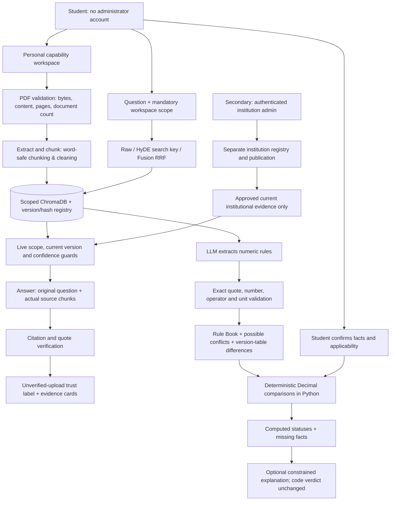

# Campus Policy Intelligence — Architecture & System Design

A student-first Campus Policy Intelligence platform built for rigorous policy discovery, query-document mismatch resolution via Hypothetical Document Embeddings (HyDE), and guardrailed evidence-grounded answer generation.

---

## 1. Core Technology Stack

- **Backend Framework:** FastAPI / Uvicorn running asynchronously on `localhost:8000`.
- **Vector Database:** **ChromaDB** persistent vector client (`.chroma/` and `.chroma-institutions/`). No external database or `pgvector` dependency; all tenant filtering is executed in-process using Chroma metadata predicates.
- **Embedding Engine:** Local **FastEmbed** using the `BAAI/bge-small-en-v1.5` model (384-dimensional dense float32 vectors, normalized). Zero third-party API embedding cost, fully private and offline-capable after local cache.
- **LLM Providers:** Dual-adapter architecture via **Groq** (OpenAI-compatible HTTP client) with secondary fallback to **Google Gemini** (`google-genai` SDK).
- **Frontend:** Single-page vanilla HTML5/CSS3/JavaScript responsive web interface (13 specialized views, supporting desktop 1440px down to mobile 390px viewports without horizontal scrolling).

---

## 2. Personal Workspaces & Dual Trust Architecture

The platform separates unverified personal exploration from authoritative institutional records:

### Personal Capability Workspaces
- Students upload documents directly without needing an institutional administrator account or institutional approval.
- Workspaces are addressed via cryptographically random 256-bit capability IDs generated with `secrets.token_urlsafe(32)`.
- The capability ID is stored client-side in browser `localStorage` and sent in the `X-Workspace-ID` header.
- Documents and vectors are stored in `data/personal/<workspace_id>/` and partitioned in Chroma with metadata filter `{"workspace_id": workspace_id}`.
- Trust label: **"Based on documents you uploaded. Not verified by your institution."**

### Institutional Workspaces (Secondary Admin Workflow)
- Multi-tenant architecture for verified college administrations (`data/workspaces/<institution_uuid>/`).
- Documents remain in `pending` review status upon upload.
- Explicit human approval bound to file SHA-256 hash, issuer, authority, and effective dates is mandatory before a document enters production retrieval.
- Unpublished institutions and unapproved sources are blocked from production retrieval by strict metadata filters.

---

## 3. Retrieval Engine: Raw, HyDE, and Fusion

Students ask questions in casual, colloquial language (e.g., *"Can I write exams if I missed classes due to fever?"*), while university handbooks use bureaucratic, formal language (e.g., *"attendance condonation subject to medical certification approved by the Head of Department"*).

### HyDE (Hypothetical Document Embeddings)
- An LLM generates a hypothetical policy handbook passage matching the topic in formal regulatory language.
- The hypothetical passage is embedded into a 384-dimensional dense vector using FastEmbed.
- **STRUCTURAL ISOLATION GUARD:** The generated HyDE text is used strictly and exclusively as a search vector key. It is **never** passed to the answer generation prompt, context window, or downstream answer LLM. The answer prompt receives only the original student question and real retrieved policy excerpts.

### Three-Way Retrieval & Scoring
1. **Raw Search:** Embeds the user question directly and ranks by cosine similarity (`1.0 - distance`).
2. **HyDE Search:** Embeds the hypothetical passage and ranks by cosine similarity.
3. **Fusion (Reciprocal Rank Fusion - RRF):** Combines the rank positions from Raw and HyDE searches using standard RRF:
   $$RRF(d) = \sum_{m \in \{raw, hyde\}} \frac{1}{60 + \text{rank}_m(d)}$$
   - **Crucial Invariant:** RRF ranking scores (e.g., `~0.033`) are maintained strictly as order ranking scores. They are **never** conflated with cosine confidence scores. For each document, its true raw cosine similarity is preserved for confidence gating.

---

## 4. Guardrails & Safety Architecture

The system enforces a multi-layered defence against hallucinations, prompt injections, and false claims:

1. **Workspace & Decoy Isolation:**
   - Every Chroma query applies mandatory metadata predicates (`workspace_id`, `is_decoy: False`, `is_synthetic: False`).
   - Workspaces cannot retrieve chunks from other personal or institutional workspaces.
2. **Confidence Gate:**
   - Evaluates the top-ranked retrieved chunk's raw cosine similarity against `CONFIDENCE_THRESHOLD = 0.35`.
   - If the best score falls below threshold, the system immediately **abstains** with:
     > *"I couldn't find a policy that covers this. Please contact the Department office or Academic section for clarification."*
   - Never fabricates permissions or assumptions when evidence is missing.
3. **XML-Delimited Grounded Prompting:**
   - Excerpts are formatted with XML tags (`<excerpt id="C1" source="...">`) with HTML entity escaping to prevent prompt injection from document text.
   - The system prompt explicitly instructs the LLM that document content is untrusted data.
4. **Citation Verification:**
   - The answer must cite claims using `[C1]`, `[C2]`, etc. Every citation is verified in Python to map to an active chunk retrieved for the query.
5. **Quote Verification:**
   - Every quoted statement in quotation marks within the generated answer is verified against the cited chunk using substring search with Unicode NFKC normalization. If any quote is altered or fabricated, the answer is rejected.
6. **Numeric & Claim Consistency Guard:**
   - Numeric values in answer sentences containing citations must physically exist within the cited chunk text. Answers with altered numbers fail closed.

---

## 5. Policy Intelligence: Rule Book & Fact Analysis

To avoid LLM arithmetic and eligibility hallucination, the platform adopts a strict design principle: **The model extracts; code decides.**

1. **Rule Extraction:**
   - LLM extracts structured numerical rules (subject, threshold value, comparison operator, unit, exceptions, exact source quote).
   - Python code validates that the quote is a verbatim substring of the source PDF chunk and that the numerical value and operator appear within the quote.
2. **Deterministic Fact Evaluation:**
   - The student states facts (e.g., *"I have 78% attendance"*).
   - The facts are confirmed by the student in the UI.
   - Evaluation is performed exclusively in Python using `decimal.Decimal` comparisons (`>=`, `<=`, etc.).
   - Missing facts, conflicting rules, or unmet conditions produce an explicit **"insufficient evidence"** or **"not satisfied"** verdict.
   - The LLM can generate a conversational explanation of the computed comparison, but it is architecturally prohibited from overriding or altering the deterministic code verdict.

---

## 6. MCP Integration

- A Model Context Protocol (MCP) server runs via standard I/O (`stdio`) in `scripts/mcp_server.py`.
- It exposes a single tool: `search_policies(query: str, limit: int = 5)`.
- It is bound strictly to a personal workspace ID provided via CLI or environment variable, preventing cross-tenant leakage.

---

## 7. Performance & Verification Limits

- **Single Process:** Designed for local evaluation on macOS/Linux with a single Uvicorn server worker.
- **Text-Only Extraction:** Relies on PyMuPDF (`fitz`) and `pdfplumber`. PDFs with scanned image-only pages or handwriting without text layers require OCR, which is intentionally out of scope.
- **Benchmark Honesty:** Benchmark accuracy metrics are displayed only when human-verified gold labels exist. Synthetic test fixtures are explicitly marked `SYNTHETIC TEST FIXTURE`.

