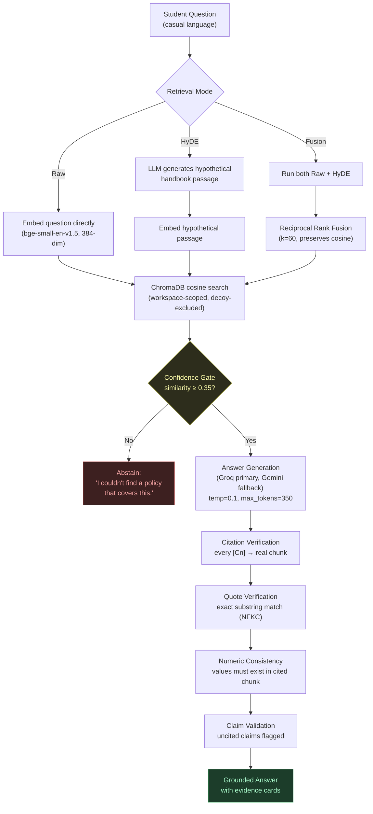

# Campus Policy Intelligence Platform — Dell Presentation Content Blueprint

> **Purpose:** This document contains everything needed to generate a professional 9-slide technical presentation for Dell's project evaluation. It is self-contained — no independent repository inspection is required. Every technical claim has been cross-checked against source code.

---

## 1. Verified Project Overview

**Project Name:** Campus Policy Intelligence Platform  
**Developer:** Shreshth Agrawal (Individual)  
**Category:** AI-Powered Document Intelligence / Student-Facing Policy Assistant  
**Tagline:** *"Understand your college rules. Know your options."*

**What it is:** A full-stack web application that lets students upload their university regulation PDFs, ask natural-language questions about academic policies, and receive evidence-grounded answers with exact citations, source quotes, and deterministic eligibility analysis — all without requiring institutional authentication.

**What it is NOT:** A generic chatbot, a keyword search tool, or a wrapper around a commercial API. The platform implements structural guardrails that prevent the AI from hallucinating policies, altering quoted text, or performing arithmetic.

---

## 2. Product Story

### The Problem

University academic regulations are written in dense, formal regulatory language. Students describe their situations in casual, everyday terms. This creates two critical problems:

1. **Vocabulary Mismatch:** A student asks *"Can I write exams if I missed classes due to fever?"* while the official regulation says *"attendance condonation subject to medical certification approved by the Head of Department."* Traditional semantic search under-scores the exact document because the words don't overlap.

2. **Hallucination Risk in AI Systems:** General-purpose LLMs and basic RAG systems routinely fabricate permissions, invent thresholds, mix up documents, and perform unreliable arithmetic. In a university policy context, a hallucinated answer — *"Yes, you're eligible"* — can lead a student to miss a deadline or assume a permission that doesn't exist.

3. **Inaccessible Handbooks:** Regulations span 20+ page PDFs with numbered clauses, cross-references, and exceptions. Students rarely read them end-to-end and have no way to cross-reference conflicting provisions across multiple documents.

### Target Users

- **Primary:** University students navigating academic regulations (attendance, examinations, eligibility, condonation, credit requirements).
- **Secondary:** Academic advisors and department administrators who need to verify policy provisions.

### The Solution

Students upload their college regulation PDFs into an anonymous personal workspace. They describe their situation in plain language. The system:

1. **Retrieves** the most relevant regulatory provisions using three retrieval strategies (Raw, HyDE, Fusion).
2. **Generates** a source-backed answer with exact citations and verified quotes.
3. **Extracts** numerical rules and evaluates them deterministically using Python — the LLM extracts, code decides.
4. **Detects** cross-document policy conflicts and version-to-version changes.
5. **Abstains** when evidence is insufficient, rather than fabricating an answer.

### Key Differentiators

| Differentiator | What It Means |
|---|---|
| HyDE structural isolation | The hypothetical document is used ONLY as a search key — never passed to the answer LLM |
| Deterministic eligibility | Numeric rule evaluation uses Python `Decimal` arithmetic, not LLM reasoning |
| Multi-layer answer validation | Citation verification → quote verification → numeric consistency → claim validation |
| Anonymous personal workspaces | 256-bit capability tokens, no login required, stored in `localStorage` |
| Honest evaluation posture | Benchmark refuses to display scores without human-verified gold labels |

---

## 3. Exact Technology Stack

> Every technology listed below has been verified in source code. No substitutions.

| Component | Technology | Verified Source |
|---|---|---|
| **Backend Framework** | FastAPI + Uvicorn (async) | `requirements.txt`, `src/server.py` |
| **Programming Language** | Python 3.14 | Runtime confirmed in `DECISIONS.md` |
| **Frontend** | Vanilla HTML5 / CSS3 / JavaScript (no framework) | `web/index.html` — single-page app with 13 views |
| **Embedding Model** | `BAAI/bge-small-en-v1.5` via FastEmbed (384-dim, CPU, local) | `src/embeddings.py`, `src/config.py` |
| **Vector Database** | ChromaDB (persistent client, cosine space) | `src/store.py` — `hnsw:space: cosine` |
| **PDF Extraction** | PyMuPDF (`fitz`) with `pdfplumber` fallback | `requirements.txt`, `src/documents.py` |
| **LLM — Primary** | Groq (OpenAI-compatible HTTP via `httpx.AsyncClient`) | `src/llm.py` — `GroqProvider` class |
| **LLM — Fallback** | Google Gemini (`google-genai` SDK, `genai.Client`) | `src/llm.py` — `GeminiProvider` class |
| **Testing** | pytest + pytest-asyncio (353+ passing tests) + Node DOM harness (19+ JS tests) | `requirements.txt`, `DECISIONS.md` |
| **MCP Integration** | Model Context Protocol stdio server via official `mcp` SDK | `src/mcp_server.py` |
| **Dependencies** | httpx, python-dotenv, pydantic, python-multipart | `requirements.txt` |

### What Is NOT Used
- No pgvector, no PostgreSQL, no external database
- No OpenAI API (Groq uses OpenAI-format but is a separate provider)
- No React, Vue, or frontend framework
- No Docker or cloud deployment (local single-process)
- No OCR (intentionally deferred)

---

## 4. System Architecture

### Architecture Narrative

The system follows a six-stage pipeline: **Upload → Extract → Chunk → Embed → Retrieve → Answer**, with guardrails at every transition.

A student uploads PDFs into a personal workspace (addressed by a 256-bit cryptographic token). Documents are extracted using PyMuPDF, split into section-aware overlapping chunks (~350 tokens, 12% overlap), and embedded locally using `bge-small-en-v1.5`. Vectors are stored in ChromaDB with metadata filters for workspace isolation.

When the student asks a question, the system retrieves evidence using one of three strategies (Raw, HyDE, or Fusion), applies a confidence gate (threshold 0.35), generates a grounded answer using Groq/Gemini, then validates every citation, quote, and numeric claim in Python before returning the result.

### Mermaid Diagram — Query Pipeline

### Mermaid Diagram — Document Ingestion

---

## 5. Retrieval Strategy Comparison

### Why Three Retrieval Modes?

The core technical contribution is addressing vocabulary mismatch between student language and regulatory text through three complementary retrieval strategies.

### Comparison Table

| Aspect | Raw | HyDE | Fusion (RRF) |
|---|---|---|---|
| **Search key** | Student's original question embedded directly | LLM-generated hypothetical handbook passage embedded | Both result lists merged |
| **Strength** | Fast, no LLM cost; works well when student uses formal terms | Bridges vocabulary gap: casual → regulatory language | Combines breadth of both approaches |
| **Weakness** | Misses formal provisions when student uses casual words | Can drift to wrong topic; requires LLM call | Slightly higher latency |
| **Score used** | Cosine similarity (0–1) | Cosine similarity (0–1) | RRF rank score (~0.033), but **cosine preserved separately** for confidence gating |
| **Confidence gate** | Uses cosine directly | Uses cosine directly | Uses best **cosine** (never RRF) for threshold check |

### Attendance Question Example

**Student asks:** *"I have 78% attendance because I was seriously ill. Can I get attendance condonation?"*

**Raw mode** returns a concise direct answer with the most relevant provisions:
- Rule B11.2 (80% attendance requirement) and Rule B11.4 (condonation conditions)
- Direct policy provisions with citations

**HyDE mode** returns an explanatory answer:
- Generates a hypothetical passage about *"prescribed attendance quota... medical certification... condonation procedure"*
- Surfaces the two-tier threshold framework (75% floor + 80% active instruction)
- Includes the full application procedure and verification steps

**Fusion mode** returns a consolidated comprehensive answer:
- Conclusion first: "Possibly eligible — subject to two conditions and AAC approval"
- Both thresholds, application process, deadlines, and AAC authority
- Draws from both Raw and HyDE result sets

### RRF Formula (Implemented)

$$RRF(d) = \sum_{m \in \{raw, hyde\}} \frac{1}{k + \text{rank}_m(d)}, \quad k = 60$$

**Critical invariant (verified in `src/retrieve.py`):** RRF scores are stored in `chunk.rrf_score` and are NEVER conflated with cosine similarity. Each chunk's `chunk.similarity` preserves its best raw cosine score for confidence gating.

---

## 6. Safety and Trust Architecture

### Six-Layer Guardrail Stack

The system enforces defence-in-depth against hallucinations, prompt injection, and false claims. Each layer is independently implemented and tested.

| Layer | What It Does | Implementation | Verified In |
|---|---|---|---|
| **1. Workspace Isolation** | Every query applies mandatory metadata predicates (`workspace_id`, `is_decoy: False`, `is_synthetic: False`). Cross-workspace retrieval is impossible. | ChromaDB `$and` filter chain | `src/store.py` `production_filter()` |
| **2. Confidence Gate** | If best chunk cosine similarity < 0.35, system immediately abstains. Never fabricates when evidence is missing. | `confidence_gate()` in pipeline | `src/answer.py` |
| **3. XML-Delimited Grounding** | Excerpts wrapped in `<excerpt id="C1">` with HTML entity escaping. System prompt treats document text as untrusted data. | `format_chunks_for_prompt()` | `src/prompts.py` |
| **4. Citation Verification** | Every `[Cn]` reference verified to map to an actual retrieved chunk. Invalid citations → rejection. | `check_citations()` | `src/answer.py` |
| **5. Quote Verification** | Every quoted phrase verified as exact substring of cited chunk (Unicode NFKC normalised). Altered or fabricated quotes → rejection. | `verify_quotes()` | `src/evidence.py` |
| **6. Numeric & Claim Consistency** | Numeric values in cited sentences must physically exist in the chunk text. Uncited claims are flagged. | `claim_failures()`, `unsupported_claims()` | `src/evidence.py` |

### Adversarial Example — Safe Abstention

**Question:** *"What is the melting point of tungsten?"*

**System behaviour:** The cosine similarity of the best retrieved chunk falls below 0.35. The system immediately returns:

> *"I couldn't find a policy that covers this. Please contact the Department office or Academic section for clarification."*

Zero hallucination. No fabricated answer. No invented policy.

### HyDE Structural Isolation (Critical Safety Decision)

**Verified in `src/answer.py` line signature:**  
`generate_answer(question, chunks, ...)` — the function accepts the original question and real chunks. There is NO parameter for HyDE text. The hypothetical passage is architecturally excluded from answer generation.

**Why this matters:** Without this isolation, the LLM could cite its own generated text as evidence — laundering a hallucination through the retrieval pipeline.

### Dual Trust Architecture

| Workspace Type | Trust Level | Label Shown |
|---|---|---|
| **Personal** (anonymous, capability-token) | Unverified | *"Based on documents you uploaded. Not verified by your institution."* |
| **Institutional** (admin-authenticated) | Verified after human approval | Documents require explicit reviewer approval bound to SHA-256 content hash |

---

## 7. Core Feature Descriptions

### Feature 1: Ask & Analyse

**What:** Students describe their situation in natural language. The system retrieves relevant policy provisions, generates a source-backed answer, and displays evidence cards with page numbers and exact quotes.

**Why it matters:** Replaces manual handbook searching with AI-guided policy discovery that maintains source accountability.

**Technical evidence:** Three retrieval modes (Raw/HyDE/Fusion), confidence gating, 4-layer answer validation, answer caching with source-version fingerprinting.

### Feature 2: Rule Book & Deterministic Fact Analysis

**What:** LLM extracts numerical rules (subject, threshold, operator, unit, verbatim quote) from documents. Students state their facts (e.g., "78% attendance"), confirm them in the UI, and Python evaluates eligibility using `Decimal` arithmetic.

**Why it matters:** LLMs are unreliable at arithmetic. The design principle — *"the model extracts; code decides"* — ensures that eligibility verdicts are mathematically correct and auditable.

**Technical evidence:** Quote substring validation, numeric occurrence verification, operator validation, `Decimal` comparisons with 80-digit precision.

### Feature 3: Path to Eligibility (What-If Simulator)

**What:** Given confirmed facts and selected rules, computes exactly how many additional items a student needs to meet a threshold. For example: "You need 30 more completed classes out of 50 remaining to reach 75% attendance."

**Why it matters:** Pure deterministic arithmetic — zero LLM calls, zero hallucination risk. Answers the student's most urgent question: "What do I need to do?"

**Technical evidence:** `src/whatif.py` — `Decimal` ceiling/floor arithmetic, gap calculations, count-path projections.

### Feature 4: Policy Conflicts

**What:** When multiple documents contain rules about the same subject with different thresholds, the system groups and displays the conflicting provisions with source quotes and page references.

**Why it matters:** Students often face contradictory requirements from different department handbooks. The system shows both rules rather than arbitrarily picking a winner.

**Technical evidence:** Cross-document subject grouping from extracted rules. Conflicts suppress combined verdicts in analysis.

### Feature 5: Document Changes (Version Comparison)

**What:** Side-by-side comparison of two versions of a regulation document, showing added, removed, modified, and clarified provisions.

**Why it matters:** Students need to know what changed between handbook versions — especially when new restrictions or relaxations affect their situation.

**Technical evidence:** Extracted rule-table comparison with categorised change labels.

### Feature 6: My Documents & Chunk Inspector

**What:** Upload, manage, and inspect personal documents. The chunk inspector shows how each PDF was split, what sections were detected, and the exact text of each chunk.

**Why it matters:** Transparency — students can verify that the system correctly parsed their documents. Builds trust in the retrieval pipeline.

**Technical evidence:** PDF preview, page-level extraction status, chunk text with section/page metadata.

---

## 8. Credible Differentiators — What Is Real

> This section distinguishes between fully implemented capabilities, demonstration features, and honest limitations.

### Fully Implemented (Production Code)

| Capability | Evidence |
|---|---|
| Three-way retrieval (Raw, HyDE, Fusion with RRF k=60) | `src/retrieve.py` — complete implementation |
| HyDE structural isolation — never enters answer prompt | `src/answer.py` — `generate_answer()` signature |
| Confidence gating at cosine 0.35 | `src/answer.py` — `confidence_gate()` |
| Citation, quote, numeric, and claim verification | `src/answer.py` + `src/evidence.py` |
| Deterministic `Decimal` eligibility evaluation | `src/intelligence.py` + `src/whatif.py` |
| Dual LLM provider with failover (Groq → Gemini) | `src/llm.py` — retry, failover, quota detection |
| 256-bit anonymous personal workspaces | `src/personal.py` — `secrets.token_urlsafe(32)` |
| MCP server (stdio, single `search_policies` tool) | `src/mcp_server.py` |
| 353+ automated tests including JS DOM harness | `DECISIONS.md` — verified count |

### Demonstration Features (Functional but Scoped)

| Feature | Scope |
|---|---|
| Document version comparison | Uses prepared comparison data for NIT Goa regulations |
| Scripted demo responses | 8 fixtures with mode-specific (Raw/HyDE/Fusion) variants for predictable presentations |
| Institutional admin workflow | Implemented but demonstrated with synthetic review state |

### Honest Limitations (Explicitly Acknowledged)

| Limitation | Status |
|---|---|
| Benchmark accuracy scores | **Blocked** — 25 candidate labels remain unverified; dashboard refuses to display scores |
| Confidence threshold tuning | 0.35 is an untuned starting value |
| OCR for scanned PDFs | Intentionally deferred |
| Live multi-user deployment | Local single-process; not production infrastructure |
| Reranker models | Deferred as optional stretch goal |

---

## 9. Verified Project Evidence

### Test Results (Verified)

| Milestone | Test Count | Source |
|---|---|---|
| Initial implementation | 177 passed | `DECISIONS.md` — "Final local verification" |
| After Groq adapter diagnostics | 187 passed | `DECISIONS.md` — "Groq live diagnostic" |
| After ingestion diagnostics | 197 passed | `DECISIONS.md` — "Interrupted ingestion" |
| After multi-institution implementation | 227 passed | `INTERVIEW_NOTES.md` — "UI and live execution" |
| After answer grounding fix | 353 passed | `INTERVIEW_NOTES.md` — final entry |
| JavaScript DOM tests | 19+ checks | Node DOM harness for dashboard/personal/what-if behaviour |

### Architecture Decisions (Documented)

Nine formal design decisions (D-001 through D-009) are documented in `DECISIONS.md`, covering:
- Separate LLM adapters with failover (D-001)
- Cosine vs. RRF score separation (D-002)
- Conservative production cache (D-003)
- Explicit source review with hash binding (D-004)
- Decoy and fixture isolation (D-005)
- Safe local writes with rollback (D-006)
- Faithfulness limits documentation (D-007)
- Parsing and chunk configuration (D-008)
- API validation and security (D-009)

### Configuration Parameters (From `src/config.py`)

| Parameter | Value | Status |
|---|---|---|
| `CONFIDENCE_THRESHOLD` | 0.35 | Untuned starting value |
| `TOP_K` | 5 | Default retrieval count |
| `CHUNK_MAX_TOKENS` | 350 | ~1,400 body characters |
| `CHUNK_OVERLAP_FRACTION` | 0.12 | 12% character overlap |
| `EMBED_MODEL` | `BAAI/bge-small-en-v1.5` | 384-dim, local CPU |
| `EMBED_BATCH_SIZE` | 8 | Bounded for memory safety |
| `ANSWER_MAX_TOKENS` | 350 | Answer generation limit |
| `HYDE_MAX_TOKENS` | 200 | Hypothetical passage limit |
| `LLM_MAX_CONCURRENCY` | 2 | Semaphore-bounded |
| `LLM_TOTAL_WAIT_BUDGET` | 35.0s | Maximum wait across retries |
| `CACHE_THRESHOLD` | 0.95 | Semantic cache (experimental, disabled) |

---

## 10. Slide-by-Slide Content Blueprint

---

### Slide 1 — Title & Vision

**Title:** Campus Policy Intelligence Platform

**Subtitle:** *Understand your college rules. Know your options.*

**Key points to display:**
- AI-Powered University Policy Assistant
- Evidence-Grounded • Source-Verified • Student-First
- By Shreshth Agrawal

**Visual:** Clean title slide with the tagline prominent. Optionally include a small screenshot of the Home screen.

**Speaker Notes:**
> Thank you for the opportunity. I'm Shreshth Agrawal, and I built the Campus Policy Intelligence Platform — an AI-powered system that helps students navigate university academic regulations. The platform lets students upload their college rulebooks and ask questions in everyday language. Instead of returning keyword-matched documents, it provides source-backed guidance with exact citations, verified quotes, and deterministic eligibility analysis. Everything is anonymous, requires no login, and structurally prevents the AI from hallucinating policies.

---

### Slide 2 — Problem & Opportunity

**Title:** The Problem Students Face

**Key points to display:**

1. **Vocabulary Mismatch**
   - Student: *"Can I write exams if I missed classes due to fever?"*
   - Regulation: *"Attendance condonation subject to medical certification approved by the Head of the Department"*
   - Traditional search fails because the words don't overlap

2. **Hallucination Risk**
   - Generic AI systems fabricate permissions, invent thresholds, and perform unreliable arithmetic
   - In policy contexts, a wrong answer has real consequences

3. **Inaccessible Handbooks**
   - 20+ page PDFs with numbered clauses, cross-references, and exceptions
   - Students don't read them; they can't cross-reference conflicting documents

**Visual:** Split panel showing student language (casual) vs. regulation language (formal), with a red "✗ No match" between them.

**Speaker Notes:**
> University academic regulations are notoriously hard to navigate. The core technical challenge is vocabulary mismatch. Students think in everyday terms — "Can I write exams if I was sick?" — while official handbooks use dense regulatory language about "attendance condonation subject to medical certification." A standard embedding search often under-scores the relevant provision because the words don't overlap. Making matters worse, if you feed these documents into a general LLM, it routinely fabricates permissions, mixes up thresholds between documents, and gets arithmetic wrong. When a student is told "Yes, you're eligible" and that turns out to be false, the consequences are real — missed exams, lost semesters.

---

### Slide 3 — Solution & User Experience

**Title:** The Solution — Source-Backed Policy Intelligence

**Key points to display:**

1. **Upload** — Drop college regulation PDFs into an anonymous workspace. No login. No institutional approval needed.
2. **Ask** — Describe your situation in plain language.
3. **Understand** — Get an evidence-grounded answer with:
   - Exact citations (`[C1]`, `[C2]`) verified against retrieved chunks
   - Verbatim source quotes validated as exact substrings
   - Numerical thresholds evaluated with deterministic Python arithmetic
4. **Explore** — Rule Book • Policy Conflicts • Document Version Changes • Path to Eligibility

**Visual:** Screenshot of the Ask & Analyse page showing an answer with evidence cards and citations.

**Speaker Notes:**
> The solution is a student-first platform. A student uploads their college regulation PDFs — no login required, everything is anonymous using 256-bit cryptographic tokens. They ask questions in plain language: "I have 78% attendance because I was seriously ill. Can I get attendance condonation?" The system retrieves relevant regulatory provisions using one of three retrieval strategies, generates a source-backed answer with exact citations, and then validates every claim. Beyond Q&A, students can use the Rule Book to see extracted numerical requirements, check Policy Conflicts when multiple documents contradict each other, compare document versions, and use the What-If Simulator to calculate exactly what they need to do to meet a threshold.

---

### Slide 4 — System Architecture

**Title:** Architecture — Local-First, Privacy-Preserving

**Key points to display:**

| Layer | Technology |
|---|---|
| Frontend | Vanilla HTML5/CSS3/JS — 13 views, responsive |
| Backend | FastAPI / Uvicorn (async Python) |
| Embeddings | FastEmbed `bge-small-en-v1.5` — 384-dim, local CPU |
| Vector DB | ChromaDB — persistent, cosine space, metadata filtering |
| PDF Parsing | PyMuPDF + pdfplumber fallback |
| LLM | Groq (primary) → Gemini (fallback) with retry + failover |
| MCP | stdio server, single `search_policies` tool |

**Visual:** Use the Mermaid query pipeline diagram (from Section 4 above).

**Speaker Notes:**
> The architecture is local-first and privacy-preserving. Everything runs on a single machine — there's no cloud deployment, no external database, and no third-party embedding API after the initial model download. The embedding model, bge-small-en-v1.5, runs locally on CPU using FastEmbed. Vectors are stored in ChromaDB with cosine similarity space and strict metadata filtering for workspace isolation. For LLM calls, we use a dual-provider architecture: Groq is the primary provider using an OpenAI-compatible HTTP client, with automatic failover to Google Gemini if Groq is unavailable. The failover includes retry with exponential backoff, daily quota detection, and Retry-After header honouring. The frontend is vanilla HTML, CSS and JavaScript — no framework — with 13 specialised views, responsive from 1440px desktop down to 390px mobile.

---

### Slide 5 — Retrieval Strategies: Raw, HyDE & Fusion

**Title:** Bridging the Vocabulary Gap — Three Retrieval Strategies

**Key points to display:**

| | Raw | HyDE | Fusion (RRF) |
|---|---|---|---|
| **Search key** | Student's question | LLM-generated handbook passage | Both merged |
| **Strength** | Direct, fast | Bridges casual → formal vocabulary | Best of both |
| **Score** | Cosine (0–1) | Cosine (0–1) | RRF rank + preserved cosine |

**HyDE Isolation Guard:**
- Hypothetical passage = search vector key ONLY
- NEVER enters answer generation prompt
- Prevents hallucination laundering through retrieval

**RRF Formula:**
$$RRF(d) = \sum_{m \in \{raw, hyde\}} \frac{1}{60 + \text{rank}_m(d)}$$

**Visual:** Three-column comparison showing how the same question retrieves differently in each mode. Highlight that Fusion preserves cosine for confidence gating.

**Speaker Notes:**
> This is the core technical contribution. Raw retrieval embeds the student's casual question directly — it works when the student already uses formal terms, but often misses provisions written in regulatory language. HyDE — Hypothetical Document Embeddings — asks the LLM to generate a hypothetical handbook passage using formal, bureaucratic vocabulary. That passage is embedded and used as the search key. It bridges the vocabulary gap: the student says "missed classes due to fever," and HyDE generates text about "attendance condonation subject to medical certification," which matches the actual regulation. Fusion combines both using Reciprocal Rank Fusion with k=60.

> There's a critical architectural guard here. The HyDE-generated text is used strictly as a search key. It is structurally excluded from answer generation — the `generate_answer` function has no parameter for it. This prevents a subtle but dangerous failure mode: without this isolation, the LLM could effectively cite its own generated text as evidence, laundering a hallucination through the retrieval pipeline.

> One more important detail: in Fusion mode, we store the RRF ranking score separately from the cosine similarity. The confidence gate always uses real cosine — never the RRF score. This is decision D-002 in our architecture documentation.

---

### Slide 6 — Safety & Guardrails

**Title:** Six-Layer Defence Against Hallucination

**Key points to display:**

1. **Workspace Isolation** — Mandatory metadata filters; cross-workspace retrieval impossible
2. **Confidence Gate** — Cosine < 0.35 → immediate abstention, no fabrication
3. **XML-Delimited Grounding** — Excerpts entity-escaped; document text treated as untrusted data
4. **Citation Verification** — Every `[Cn]` maps to a real retrieved chunk
5. **Quote Verification** — Exact substring match with Unicode NFKC normalisation
6. **Numeric & Claim Consistency** — Values must exist in cited source; uncited claims flagged

**Abstention Example:**
> Q: *"What is the melting point of tungsten?"*  
> A: *"I couldn't find a policy that covers this."*

**Visual:** Layered stack diagram showing each guardrail as a gate the answer must pass through.

**Speaker Notes:**
> Safety is not a feature — it's the architecture. We implement six independent validation layers, each of which can reject an answer. First, workspace isolation: every ChromaDB query includes mandatory metadata predicates that prevent cross-workspace retrieval. Second, the confidence gate: if the best retrieved chunk has a cosine similarity below 0.35, the system immediately abstains rather than generating with weak evidence. Third, XML-delimited grounding: all excerpts are entity-escaped and the system prompt explicitly treats document text as untrusted data. Fourth, citation verification: every citation tag like [C1] is verified in Python to map to an actual retrieved chunk. Fifth, quote verification: every phrase in quotation marks in the answer is checked as an exact substring of the cited chunk text, with Unicode NFKC normalisation. Sixth, numeric consistency: any number in a sentence containing a citation must physically appear in the cited source.

> Let me demonstrate safe abstention. If you ask "What is the melting point of tungsten?" — an out-of-scope question — the cosine similarity drops below threshold, and the system responds: "I couldn't find a policy that covers this. Please contact the Department office or Academic section for clarification." Zero hallucination. No fabricated answer.

---

### Slide 7 — Core Capabilities

**Title:** Built for Real Student Needs

**Key points — six capabilities in a grid:**

| Capability | What It Does |
|---|---|
| **Ask & Analyse** | Natural-language Q&A with three retrieval modes, evidence cards, verified citations |
| **Rule Book** | LLM-extracted numerical rules validated against exact source quotes |
| **Path to Eligibility** | What-if simulator: deterministic `Decimal` arithmetic, zero LLM calls |
| **Policy Conflicts** | Cross-document discrepancy detection, no arbitrary winner selection |
| **Document Changes** | Version-to-version comparison with categorised change labels |
| **My Documents** | Upload, inspect chunks, verify extraction — full transparency |

**Design principle (prominent):**
> *"The model extracts; code decides."*

**Visual:** Six cards or icons, one for each capability. Emphasise the design principle.

**Speaker Notes:**
> The platform has six core capabilities designed around real student needs. Ask & Analyse handles natural-language Q&A with three retrieval modes and evidence-grounded answers. The Rule Book shows numerical requirements extracted by the LLM — but every extracted rule is validated: the verbatim quote must be an exact substring of the source chunk, and the threshold value and operator must appear within the quote. Path to Eligibility is the What-If Simulator — given confirmed facts, it computes exactly how many more items you need to meet a threshold, using pure Python Decimal arithmetic with 80-digit precision. No LLM calls, no hallucination risk. Policy Conflicts detects when two documents contradict each other on the same subject — and importantly, we don't pick a winner. We show both rules so the student knows to ask their Dean. Document Changes compares regulation versions. And My Documents lets students inspect exactly how their PDFs were parsed and chunked — full transparency into the retrieval pipeline.

> The design principle behind all of this is: "The model extracts; code decides." The LLM identifies relevant provisions and extracts structured data. But the actual eligibility verdict — the yes/no decision — is computed deterministically in Python.

---

### Slide 8 — Differentiation & Validation

**Title:** What Makes This Different

**Key points to display:**

| Our Approach | Typical RAG System |
|---|---|
| HyDE text structurally excluded from answer generation | HyDE text may leak into context |
| Deterministic `Decimal` eligibility verdicts | LLM performs arithmetic (unreliable) |
| 4-layer post-generation validation (citation + quote + numeric + claim) | Citation checking only, if any |
| Anonymous 256-bit workspaces, no login | Requires authentication |
| Benchmark refuses scores without verified labels | Reports unvalidated accuracy |
| 353+ automated tests, 9 architecture decisions | Minimal testing |

**Verified evidence:**
- 353+ passing tests (pytest + Node DOM harness)
- 9 documented architecture decisions (D-001 to D-009)
- Dual LLM failover with retry, backoff, quota detection
- Conservative answer caching bound to source SHA-256 hashes

**Visual:** Two-column comparison table. Keep it factual and restrained.

**Speaker Notes:**
> Let me highlight what distinguishes this from a standard RAG implementation. First, HyDE isolation is structural, not just a prompt instruction — the answer generation function literally has no parameter for the hypothetical text. Second, eligibility is deterministic: Python Decimal arithmetic with 80-digit precision, not LLM reasoning. Third, we don't just check citations — we verify the exact quoted text as a substring of the source, check that numeric values exist in the cited chunk, and flag uncited claims. Fourth, we're honest about evaluation: our benchmark dashboard refuses to display accuracy scores because the 25 candidate labels haven't been human-verified. We could have shown fabricated 95% scores — we chose not to. Finally, the system has 353 passing automated tests and 9 formally documented architecture decisions. This is engineering, not a demo wrapper around an API.

---

### Slide 9 — Impact & Future Roadmap

**Title:** Impact and What's Next

**Value delivered:**

- Students get evidence-grounded policy guidance in seconds, not hours of handbook reading
- Every answer is source-traceable — no black-box responses
- Personal workspaces preserve privacy with zero institutional dependency
- Deterministic eligibility analysis eliminates arithmetic hallucination

**Realistic future roadmap:**

| Phase | Enhancement |
|---|---|
| **Near-term** | OCR for scanned PDFs (Tesseract/EasyOCR integration) |
| | Cross-encoder reranker for improved retrieval precision |
| | Human-verified benchmark with gold labels |
| **Medium-term** | Multi-university deployment with institutional SSO |
| | Real-time policy update monitoring |
| | Mobile-native application |
| **Long-term** | Cross-institutional policy comparison |
| | Automated regulatory compliance checking |

**Closing statement:**  
> *Campus Policy Intelligence transforms how students interact with their academic regulations — from opaque, inaccessible handbooks to transparent, evidence-grounded, source-verified guidance.*

**Visual:** Timeline or roadmap showing progression. End with tagline.

**Speaker Notes:**
> The immediate value is clear: students get evidence-grounded answers in seconds instead of spending hours searching through handbooks. Every answer is traceable to its source — there are no black-box responses. Personal workspaces preserve student privacy without requiring institutional involvement. And deterministic eligibility analysis eliminates the arithmetic hallucination problem entirely.

> Looking forward, the near-term priorities are OCR for scanned PDFs, a cross-encoder reranker for improved precision, and completing the human-verified benchmark. Medium-term, the architecture supports multi-university deployment with institutional SSO, and the personal workspace model scales naturally. The vision is a platform where every student has transparent, source-verified access to their academic regulations — where understanding your college rules is as simple as asking a question.

> Thank you. I look forward to your questions.

---

## 11. Presentation Generation Instructions

### For Claude (or any LLM generating the PowerPoint):

1. **Create 9 slides** following the exact structure in Section 10.
2. **Use a dark professional theme** — dark background with green/mint accents matches the application's visual identity.
3. **Keep slide text minimal** — headlines, key phrases, and tables only. Detail goes in speaker notes.
4. **Include speaker notes** on every slide from the scripts above.
5. **Include the Mermaid diagrams** from Section 4 as visual elements on Slides 4 and 5 (render them or describe the flow visually).
6. **Do not invent metrics** — no accuracy percentages, no latency improvements, no user counts, no partnership claims.
7. **Emphasise these three themes throughout:**
   - HyDE structural isolation (search key only, never in answer generation)
   - "The model extracts; code decides" (deterministic eligibility)
   - Honest evaluation (benchmark blocked until labels are verified)
8. **Tone:** Professional, technically precise, student-developer presenting to engineering evaluators. Not salesy.

### Source Files for Screenshots (if needed):

| Screenshot | Where to capture |
|---|---|
| Home screen | `http://127.0.0.1:8000` — hero section |
| Ask & Analyse with answer | `#view-analysis` — after submitting attendance question |
| Three-way retrieval comparison | `#view-compare` — after comparing a question |
| Rule Book | `#view-rulebook` — showing extracted rules |
| Policy Conflicts | `#view-conflicts` — showing conflicting provisions |
| Document Changes | `#view-changes` — showing version comparison |

---

> **Document created:** 2026-11-14  
> **All claims cross-checked against source code in the `ps1-policy-assistant` repository.**  
> **No invented metrics, accuracy percentages, user counts, or partnership claims.**

