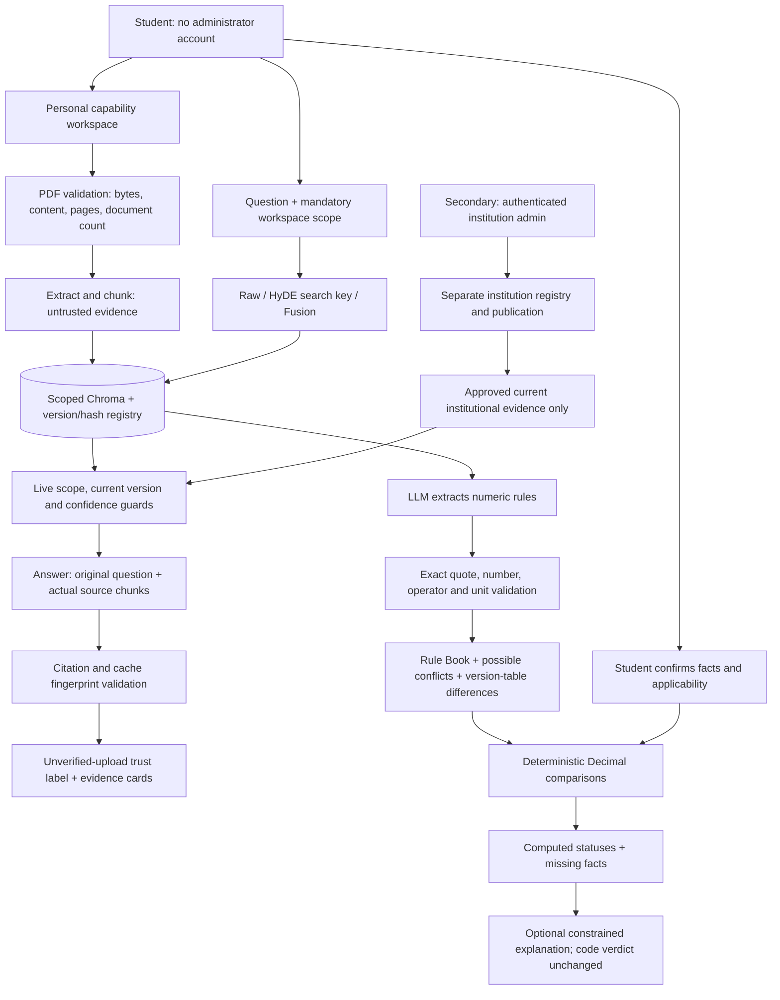

# Campus Policy Intelligence architecture

Personal workspaces use `data/personal_workspaces.json` and `data/personal/<workspace_id>/`. Each ID has 256 random bits from `secrets.token_urlsafe(32)`. The browser stores it in localStorage and sends `X-Workspace-ID`; possession grants access. Personal document URLs contain a one-way owner fingerprint and document UUID, not the raw workspace capability. There is no public workspace enumeration. Deleting a personal workspace removes only its own files and scoped vectors.

The immutable scope context carries either an institution ID or a personal workspace ID. Every vector query, mutation, registry, manifest and cache operation uses that scope. Personal metadata contains workspace_id and an empty institution_id; institutional metadata remains institution-owned. A single local Chroma collection retains mandatory predicates before ranking. Existing institutional records are not migrated, approved, published or rewritten for this change.

Trust is explicit: personal uploaded evidence is unverified and never marked institutionally approved. Personal production retrieval permits current successfully indexed uploads with matching hashes, while retaining decoy/synthetic safeguards. Institutional production retrieval continues requiring explicit human approval, current hash/version and publication. Both retain confidence gating, citation checks and cache source fingerprints. No query silently mixes trust levels.

Rule extraction is cached by workspace/document/file hash, prompt and model. Quotes must be exact source substrings; numeric values, operators and units must be supported by them. Retained rules remain AI extractions requiring inspection. Code compares confirmed facts using Decimal and returns satisfied/not satisfied/insufficient evidence. Missing applicability, units, facts, unresolved exceptions or conflicts prevent a positive eligibility conclusion. The model cannot set or overwrite the computed verdict.

Conflicts are possible conflicts between same-subject rules in separate documents; no winner is inferred from dates. Version comparison reads owned retained originals and compares validated rule tables. Historical rules never enter current retrieval/analysis. Rule-table changes do not establish official policy changes or applicability.

The local MVP uses one server process and JSON/Chroma locks. Stop the server before CLI writers. Crash-proof distributed jobs, OCR, enterprise authentication, automatic semantic verification of extractions and remote deployment are not implemented.
